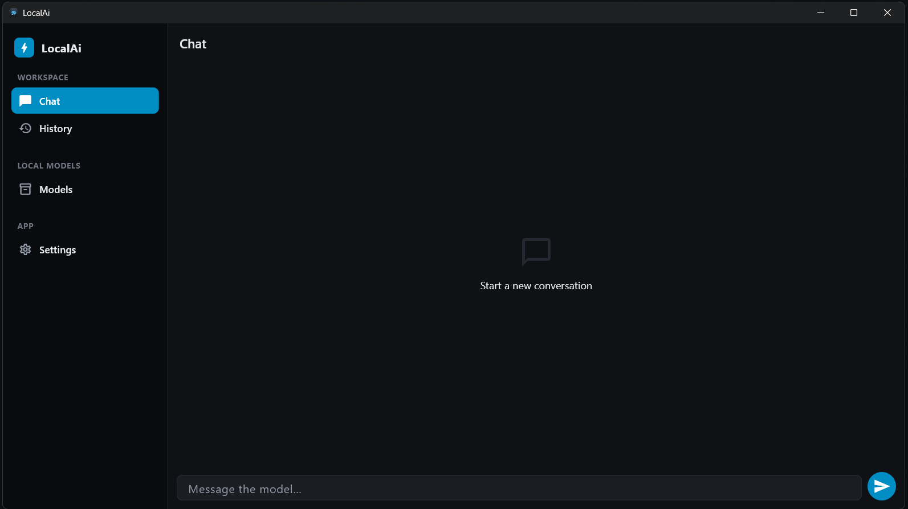
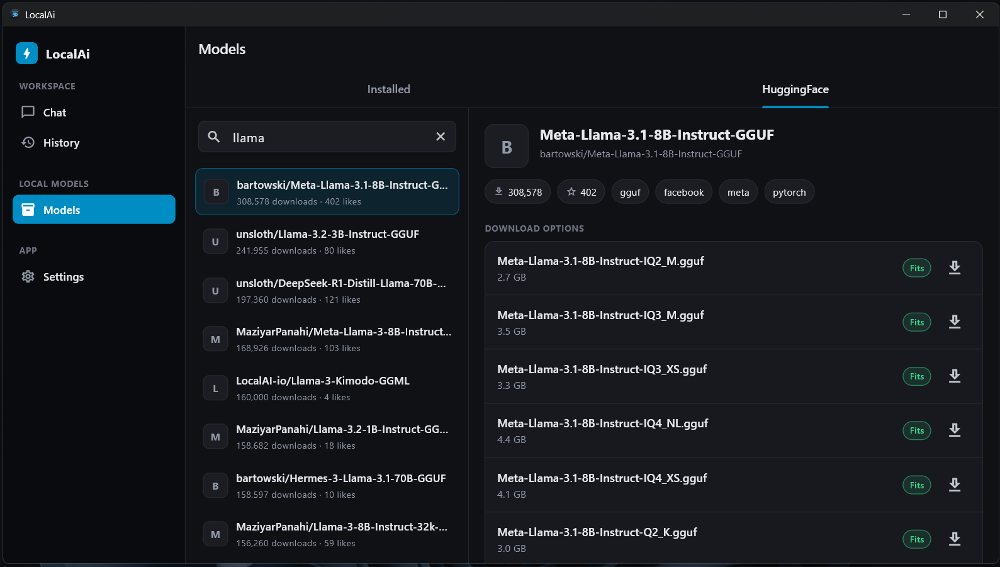
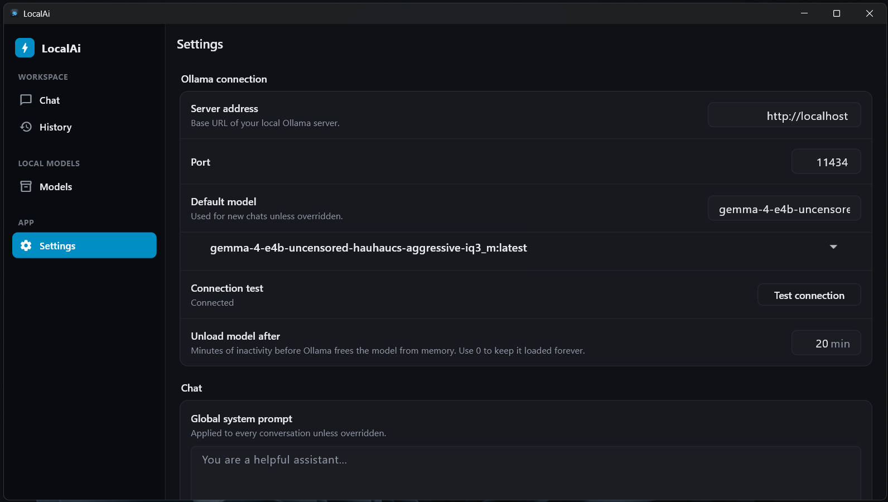

# LocalAi

**LocalAi** is a lightweight local-first, offline AI chat client for Flutter. It can run models
two ways: **on-device** with [llama.cpp](https://github.com/ggml-org/llama.cpp) embedded directly
in the app via FFI (no server, no background service), or **remote** against a
[Ollama](https://ollama.com) server running on your machine, your LAN, or a remote host. Either
way, conversations, model downloads, and inference happen on hardware you control.

It runs today on **Windows** and **Android**, with a responsive adaptive shell that also
targets **Web**.

## Features

- **Two inference backends, switchable in Settings**:
  - **On-device (embedded llama.cpp)** — models run inside the app through FFI. This is the
    recommended mode on Android: there is no separate Ollama server or foreground service to
    keep alive, which removes the biggest source of jank and battery drain on phones.
  - **Remote (Ollama)** — chat streams from an Ollama server, whether it is on the same device,
    elsewhere on your LAN, or a remote host.
- **Offline-first chat**: streamed responses with cancellable in-flight requests and a persistent
  conversation history stored in a local SQLite database (via
  [Drift](https://drift.simonbinder.eu/)).
- **Model library**: browse and search [Hugging Face](https://huggingface.co) for GGUF models.
  Downloads go straight into the embedded engine's model folder on-device, or are registered with
  Ollama on the remote backend. Manage what's installed (list, delete one, or wipe all).
- **Hardware-aware recommendations**: detects total RAM, free disk, and GPU on the current device
  and flags whether a given model comfortably **fits**, is **tight**, or is **too large** for your
  machine before you download it.
- **Adaptive UI shell**: a grouped sidebar navigation on desktop/tablet widths and a bottom
  navigation bar on phone widths, built with `go_router`'s
  `StatefulShellRoute.indexedStack` for instant, state-preserving tab switches.
- **Rich message rendering**: Markdown, syntax-highlighted code blocks, and sandboxed HTML block
  rendering inside chat bubbles.
- **Configurable inference settings**: system prompt, temperature, context length, and model
  keep-alive duration (remote backend).
- **Light/dark theming** that follows the system or can be pinned manually.

## On-device inference

The embedded engine is powered by
[`llm_llamacpp`](https://pub.dev/packages/llm_llamacpp), a Dart FFI binding to llama.cpp. The
native libraries ship as Flutter *native assets* produced by the package's build hook: on the
first `flutter build` the hook downloads a prebuilt bundle for your target (or compiles llama.cpp
from source), and Flutter bundles the `.so`/`.dll`/framework into the app. There is no manual
`jniLibs` copying and no library path to configure.

Requirements and notes:

- **Android**: the bundled libraries are built against `android-28`, so the app sets
  `minSdk = 28`. On arm64 a Vulkan GPU backend and multiple ARM CPU variants are included, with
  `libomp.so` for threading.
- **Windows**: the prebuilt ships `llama.dll` plus the `ggml*` backends.
- **Build hosts without `unzip`** (notably Windows): the build hook extracts the prebuilt bundle
  with the Unix `unzip` command. Install it (Git for Windows ships one at
  `C:\Program Files\Git\usr\bin\unzip.exe`; add that directory to `PATH`) or let the hook fall
  back to a from-source CMake build.

## Screenshots


<p align="center">
  
</p>
<p align="center">
  
  
</p>

## Architecture

The codebase follows a layered structure:

```
lib/
  core/        Cross-cutting concerns: DI (Riverpod providers), routing (go_router),
               theming, the adaptive shell, and shared utilities.
  data/        Concrete implementations: local Drift database, the on-device GGUF
               store, Ollama/Hugging Face HTTP clients, per-platform hardware
               detectors, model downloader.
  domain/      Business logic: entities, the InferenceEngine contract, repositories,
               and use cases such as the model-recommendation and
               content-block-parsing services. `OllamaEngine` (remote) and
               `LlamaCppEngine` (on-device) both implement InferenceEngine.
  presentation/ Screens and controllers for chat, history, model library, and settings,
               organized by feature.
```

- **State management:** [Riverpod](https://riverpod.dev)
- **Routing:** [go_router](https://pub.dev/packages/go_router)
- **Local persistence:** [Drift](https://drift.simonbinder.eu/) (SQLite) +
  `flutter_secure_storage` for secrets
- **Networking:** [Dio](https://pub.dev/packages/dio)
- **Inference backends:** pluggable via the `InferenceEngine` interface.
  `OllamaEngine` talks to a remote/local Ollama server; `LlamaCppEngine` runs GGUF
  models on-device via [`llm_llamacpp`](https://pub.dev/packages/llm_llamacpp) (Dart
  FFI to llama.cpp). `activeEngineProvider` selects one from the saved backend setting.

## Prerequisites

- [Flutter SDK](https://docs.flutter.dev/get-started/install) 3.44.x or later
  (Dart SDK `^3.12.2`), on the **stable** channel.
- For the **on-device** backend: nothing beyond the platform toolchains below. The
  llama.cpp native libraries are fetched automatically by the `llm_llamacpp` build hook.
- For the **remote** (Ollama) backend: [Ollama](https://ollama.com/download) installed
  and running, reachable from the device you run LocalAi on (`http://localhost:11434`
  by default; set your device/LAN IP if running on a physical Android device against a
  desktop Ollama instance).
- Platform-specific tooling for whichever target you build:
  - **Windows:** Visual Studio 2022 with the "Desktop development with C++" workload.
  - **Android:** Android Studio with an installed SDK/NDK (r27+ for 16 KB page support),
    or just the command-line tools (`flutter doctor` will tell you what's missing).
  - **Web:** `Experimental - Not tested` no extra tooling beyond Flutter's web support (`flutter config --enable-web`
    if it isn't already enabled).

Verify your setup:

```sh
flutter doctor
```

## Getting started

1. (Remote backend only) Install Ollama:

    - Windows `PowerShell`: 

        ```sh 
        irm https://ollama.com/install.ps1 | iex
        ```
    - Linux & macOS: 
        ```sh 
        curl -fsSL https://ollama.com/install.sh | sh
        ```

2. Clone the repository and fetch dependencies:

   ```sh
   git clone https://github.com/lazarus-muya/localai.git
   cd localai
   flutter pub get
   ```

3. Generate the Drift/Freezed/JSON-serializable code (required after a fresh clone, and
   any time you change a `@freezed`, `@JsonSerializable`, or Drift table definition):

   ```sh
   dart run build_runner build --delete-conflicting-outputs
   ```

   During active development, keep this running in watch mode instead:

   ```sh
   dart run build_runner watch --delete-conflicting-outputs
   ```

4. Make sure Ollama is running and reachable:

   ```sh
   ollama serve
   ```

5. Run the app on a connected device or emulator:

   ```sh
   flutter run
   ```

   Or target a specific platform:

   ```sh
   flutter run -d windows
   flutter run -d <android-device-id>   # see `flutter devices`
   ```

6. On first launch, open **Settings** and pick a backend tab:

   - **On-device**: choose (or type) a **Default local model**, then download a GGUF
     from the **Models** tab. Nothing else is required — inference runs in the app.
   - **Remote**: confirm the Ollama server URL/port point at your running instance, use
     **Test connection** to verify connectivity, and pull a model from the **Models**
     tab (or via `ollama pull <model>` directly).

   Press **Save settings**, then start a chat.

## Build instructions

### Windows (desktop)

```sh
flutter build windows --release
```

Output: `build\windows\x64\runner\Release\` (contains `localai.exe` plus the bundled
`llama.dll`/`ggml*.dll` native assets and the `data\` asset bundle: copy the whole folder
to distribute).

> On a build host without `unzip`, the `llm_llamacpp` hook cannot extract its prebuilt
> bundle. Install `unzip` (Git for Windows provides
> `C:\Program Files\Git\usr\bin\unzip.exe`) and add it to `PATH`.

### Android

```sh
# single binary - large apk size as it compiles for all arch
flutter build apk --release
# split binaries per arch - Recommended for smaller apk
flutter build apk --split-per-abi
# or, for Play Store distribution:
flutter build appbundle --release
```

Output: `build\app\outputs\flutter-apk\`

> The APK bundles the on-device llama.cpp libraries per ABI (`libllama.so`, the
> `libggml*` backends, and `libomp.so`), which is why `--split-per-abi` produces much
> smaller downloads when you only ship arm64 devices.

> The debug build signs with the debug keystore. For a release you intend to distribute,
> configure your own signing config in `android/app/build.gradle.kts` before building
> (see the `TODO` markers in that file).

### Web

```sh
flutter build web --release
```

Output: `build\web\`: serve it with any static file host. Note that a browser sandbox
cannot reach `localhost:11434` on a *different* machine than the one serving the page,
and Ollama's default config only listens on localhost: set `OLLAMA_HOST=0.0.0.0` on the
Ollama host and point LocalAi's server URL at that machine's LAN address if you need
cross-device access.

## Running tests

```sh
flutter test
```

## Project configuration notes

- The Dart package name (`localai`), Android application ID
  (`com.localai.localai`), and Windows binary name (`localai.exe`) are internal build
  identifiers and are intentionally left unchanged from the app's user-facing name,
  **LocalAi**, which appears in the window title, Android launcher label, and web
  manifest/tab title.
- Local chat history is stored in a Drift/SQLite database on-device; nothing is synced
  to a remote service.
- On-device GGUF models are stored in the app's support directory under `models/`; the
  remote backend's staged downloads are deleted after the model is registered with
  Ollama.
- Android `minSdk` is pinned to 28 because the bundled llama.cpp libraries are built
  against `android-28`.

## Contributing

This project is under active development (see git history for the current phase). Run
`flutter analyze` and `flutter test` before opening a PR.

## License

Licensed under **AGPL-3.0 with the Commons Clause condition** — see [LICENSE](LICENSE).
In short: the source is public, you're free to use, study, modify, and redistribute it
(and any modified/hosted version must also publish its source), but **selling the
software or its source code, or offering it as a paid product/service, is not
permitted**. Contact the maintainer for a separate commercial license if you need rights
beyond this.
